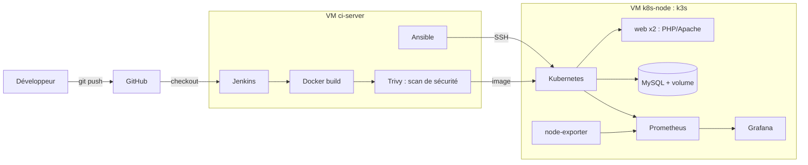

# devops-lab : chaîne DevOps complète sur une application PHP/MySQL

Projet de laboratoire réalisé par Paul Dembo Sagna : automatisation du build, de l'analyse de sécurité, de la configuration des serveurs, du déploiement sur Kubernetes et de la supervision d'une application PHP/MySQL.

## Architecture



## Outils

| Outil | Rôle |
|---|---|
| Ubuntu Server 22.04 | Système des deux VM (VMware) |
| Git / GitHub | Gestion du code source |
| Jenkins | Pipeline CI : checkout, build, scan |
| Docker / Docker Compose | Conteneurisation et exécution en local |
| Trivy | Scan de vulnérabilités, avec échec sur CRITICAL corrigeable |
| Ansible | Configuration des serveurs et installation de k3s |
| k3s (Kubernetes) | Orchestration de l'application |
| Prometheus / Grafana | Collecte des métriques et tableaux de bord |

## Structure du dépôt

| Chemin | Contenu |
|---|---|
| `app/` | Application PHP |
| `Dockerfile`, `docker-compose.yml` | Image et exécution locale |
| `Jenkinsfile` | Pipeline : Checkout, Build, Security scan, Verify |
| `jenkins/` | Dockerfile de l'image Jenkins (avec client Docker) |
| `ansible/` | Inventaire et playbooks (`base.yml`, `k3s.yml`) |
| `k8s/` | Manifests : Secret, MySQL, web, supervision |

## Lancer en local

```bash
docker compose up -d --build
curl localhost:8080
```

## Limites connues et améliorations prévues

- Les secrets Kubernetes sont encodés et non chiffrés : prévoir le chiffrement au repos ou Vault.
- Les données Prometheus ne sont pas persistantes.
- L'image est transférée manuellement vers k3s : prévoir un registre (GHCR ou Docker Hub).
- Le déploiement Kubernetes n'est pas encore déclenché par Jenkins (étape de CD à ajouter).
- Terraform non intégré : l'infrastructure est locale (VMware).
